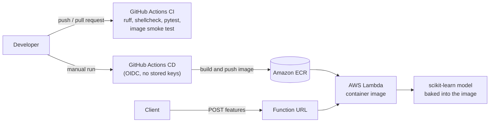

# ml-deploy-reference

[](https://github.com/pemariano/ml-deploy-reference/actions/workflows/ci.yml)
[](LICENSE)


An end-to-end reference for taking a machine learning model from code to a running AWS service: **tested, containerized, deployed with reproducible scripts, and torn down with one command**.

The model is intentionally a placeholder (a scikit-learn `LogisticRegression` trained on synthetic data). The point of this project is everything *around* the model, which is what makes ML work reliably in production.

## What this project demonstrates

| Area | What is in the repo |
|---|---|
| **Serving** | AWS Lambda handler packaged as a container image, with strict input validation and safe error responses |
| **Quality gates** | 66 unit tests (100% coverage of the application code), `ruff` lint and format, `shellcheck`, pre-commit hooks |
| **CI** | GitHub Actions: lint, tests with coverage, then builds the image and smoke-tests it through the Lambda Runtime Interface Emulator |
| **CD** | Manual, on-demand GitHub Actions workflow that deploys or destroys the stack. It authenticates to AWS with **OIDC**, so no access keys are stored anywhere |
| **Infrastructure** | Idempotent AWS CLI scripts, one per service (ECR, IAM, Lambda, Function URL), plus a `destroy` script that leaves nothing behind |
| **Reproducibility** | Locked dependencies (`uv.lock`), pinned tool versions, and a step-by-step guide to recreate everything in a fresh AWS account |

## Architecture



Request and response:

```text
POST  {"features": [1.0, -0.5, 2.3, 0.1]}   ->   200  {"prediction": 1, "probability": 0.7171}
```

| Situation | Status | Body |
|---|---|---|
| Valid request | 200 | `{"prediction": 0 or 1, "probability": 0.xxxx}` |
| Body is not valid JSON, or not a JSON object | 400 | `{"Error": "..."}` |
| `features` missing, empty, non-numeric, `NaN` or `Infinity` | 400 | `{"Error": "Field 'features' must be a non-empty list of finite numbers."}` |
| Wrong number of features | 400 | `{"Error": "Expected 4 features, got N."}` |
| Any unexpected failure | 500 | `{"Error": "Internal server error."}` (details only in the logs) |

## Engineering decisions
 
Not every choice here would be right in production. They are split in two groups: what I would keep in a production system, and what I simplified on purpose because this is a study project. The gaps the second group leaves are listed under [Known limitations](#known-limitations).
 
**Built to production standards**
 
- **Container image instead of a zip.** The scikit-learn and NumPy stack is large and has native dependencies, and the same image runs locally and in the cloud, so what is tested is what is deployed.
- **The model is cached in memory** (`lru_cache`), so warm invocations do not read the file again, and the cache is cleared after retraining.
- **Client errors and server errors are kept apart.** Input is validated before inference (finite numbers, and the number of features read from the model itself) and bad input returns 400 with a useful message. Internal failures return a generic 500, with the detail only in the logs, so nothing internal leaks to the caller.
- **No long-lived cloud credentials.** CD uses GitHub's OIDC tokens, and the AWS role only accepts tokens from this repository on the `main` branch.
- **Idempotent deploy scripts.** Every step checks what already exists, so running it again updates instead of failing, and changing the function URL's auth type also fixes the permissions that go with it.
- **Reproducible builds.** Dependencies come from `uv.lock`, the `uv` image is pinned, and the pre-commit hook uses the same `ruff` version as CI.
- **Automated gates around the deploy.** CI runs lint, tests and a smoke test of the real image. CD runs the tests before deploying, and a post-deploy smoke test fails the run unless the function returns 200 with a prediction.

**Simplified because this is a study project**
 
- **A placeholder model, trained at build time and baked into the image.** The deployed function needs no external storage, and the model always matches the libraries that load it. In production, the model would be a versioned artifact (for example in S3 or a registry), trained in its own pipeline and loaded by version.
- **Deploys are manual only.** The CD workflow runs only when started by hand, so no commit can create cloud resources or a bill, and a matching `destroy` action removes everything. In production, deploys would run automatically behind approvals and checks, across several environments.
- **AWS CLI scripts instead of infrastructure as code.** Each script is short and easy to read, which is good for learning how every service is wired. In production, Terraform or CDK would add state, drift detection and rollback.
- **One function, one environment, and a Function URL as the endpoint.** This keeps the setup small. In production, I would put API Gateway in front for authentication and throttling, and separate dev, staging and production.
- **A broad role for CI.** It has `AdministratorAccess`, because the deploy creates IAM roles and a least-privilege policy was not worth the effort here. In production, the policy would be narrowed to exactly what the deploy needs.
- **Memory and timeout are defaults, not measurements.** In production, they would come from load testing.

## Quick start (local, no AWS account needed)

Requirements: [uv](https://docs.astral.sh/uv/), Python 3.13 and [Docker](https://docs.docker.com/get-docker/).

```bash
git clone https://github.com/pemariano/ml-deploy-reference.git
cd ml-deploy-reference

make install      # install dependencies
make test         # unit tests with coverage (fails below 80%)
make build        # build the Lambda image (the model is trained inside it)
make run          # start the container on http://localhost:9000
make invoke       # in a second terminal: send a sample request
```

The container runs the Lambda Runtime Interface Emulator, so it behaves like the real service. Run `make help` to list every target.

There is also a small CLI that uses the same model code:

```bash
uv run python cli.py train
uv run python cli.py predict --features "1.0,2.0,3.0,4.0"
```

## Deploy it to your own AWS account

The full, step-by-step guide is in **[docs/deploy-to-aws.md](docs/deploy-to-aws.md)**. It covers creating safe AWS credentials, deploying from your terminal or from GitHub Actions, testing, cleaning up, and a troubleshooting table.

In short:

```bash
make deploy       # ECR, IAM role, Lambda function and Function URL
make destroy      # deletes everything it created
```

An idle Lambda function costs nothing. The guide explains the small costs that remain (stored images and logs) and how to set a budget alert first.

## Project structure

```text
.
├── app/app.py                      # Lambda handler
├── src/
│   ├── model.py                    # train, load (cached) and predict
│   └── status_code_enum.py         # HTTP status codes
├── cli.py                          # local CLI
├── tests/                          # pytest, given/when/then naming
├── scripts/                        # AWS CLI deployment, one script per step
│   ├── config.sh                   #   shared settings
│   ├── 01_ecr.sh                   #   repository, login, build, push
│   ├── 02_iam.sh                   #   execution role
│   ├── 03_lambda.sh                #   function create or update
│   ├── 04_function_url.sh          #   HTTPS endpoint and permissions
│   ├── deploy.sh / destroy.sh      #   run all steps / remove everything
│   └── setup_github_oidc.sh        #   one-time role for GitHub Actions
├── docs/deploy-to-aws.md           # how to reproduce the infrastructure
├── .github/workflows/              # ci.yml and cd.yml (manual)
├── Dockerfile                      # AWS Lambda Python base image
├── Makefile                        # install, lint, test, build, run, invoke, deploy, destroy
└── pyproject.toml, uv.lock         # dependencies, locked
```

## Tech stack

Python 3.13, scikit-learn, NumPy, Click, pytest, ruff, pre-commit, uv, Docker, GitHub Actions, AWS Lambda, Amazon ECR, IAM and the AWS CLI.

## Known limitations
 
This is a reference project, not a production system. These are the main gaps in the current version, grouped by area. Several of them are what the next section addresses.

**Serving**
 
- **Few controls on who can call it.** The function is exposed through a Function URL only: no API Gateway, throttling, API keys or WAF. With `AUTH_TYPE=NONE` anyone with the URL can call it and generate invocations.
- **A narrow API contract.** The handler accepts one event shape (a proxy-style event with a JSON string body), ignores `isBase64Encoded`, and has no CORS configuration. The 4-feature input is enforced at runtime but not published as a schema (for example OpenAPI) or versioned.
- **Sizing was not measured.** The model loads on the first request (cold start), and the 1024 MB memory and 30 s timeout were chosen without load testing.
- **Model load** The model is trained on every image build instead of being pulled from a stored artifact. The Dockerfile trains a new model each time the image is built, rather than downloading a versioned artifact (for example from S3).

**Security**
 
- **The CI role is broad.** It has `AdministratorAccess`, limited only by a trust policy that accepts tokens from this repository on `main`. A least-privilege policy would be safer.
- **Supply chain checks are partial.** GitHub Actions are pinned by version tag, not by commit SHA. ECR scans images on push, but the pipeline does not read the results, and there is no automated dependency update.

**Observability and testing**
 
- **Minimal observability.** Logs are plain text, and there are no custom metrics, alarms or tracing beyond the CloudWatch defaults.
- **The AWS scripts are only linted.** `shellcheck` checks them and a real deploy exercises them, but there are no automated tests for them, and there are no load or contract tests.

**Infrastructure and delivery**
 
- **Shell scripts instead of infrastructure as code.** There is no state, no drift detection and no rollback: if a step fails halfway, you re-run it or destroy everything. There is a single environment, with no dev, staging or production separation.
- **CD gates are thin.** It runs the unit tests but does not require the CI run for that commit (lint, image smoke test) to have passed. If its post-deploy smoke test fails, the function stays on the new image: there is no automatic rollback.
- **Mixed architectures are handled by convention.** The runner is x86_64, so an `arm64` image is built under QEMU emulation (slow), and keeping the same architecture across deploys depends on the operator, because the scripts only set it when the function is created.

## What I would add next

- Store model artifacts in S3 with versioning and a simple registry, and load them by version instead of baking them into the image.
- Put API Gateway in front of the function for authentication, throttling and usage plans.
- Observability: structured logs, CloudWatch alarms on errors and latency, and tracing.
- Describe the infrastructure as code (Terraform or CDK) in place of the CLI scripts, with Lambda versions and aliases for canary releases.

## License

Apache License 2.0. See [LICENSE](LICENSE).

## Author

Pedro Mariano · [GitHub](https://github.com/pemariano) · [LinkedIn](https://linkedin.com/in/pemariano)
